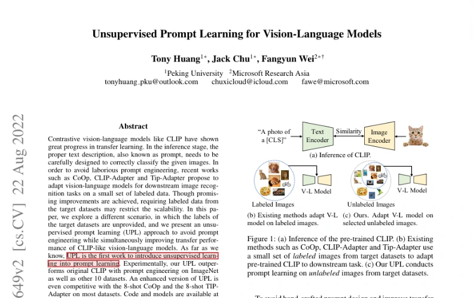

# 研知 Research Desk：从论文资料库到可核对的回答

准备一次组会时，你可能已经收集了十几篇论文。导师问「这几种方法用了哪些标注数据」，你记得读过相关内容，却得重新打开 PDF，逐篇查实验设置。即使用模型先列出差异，最后还要确认每一条来自哪篇论文、原文说了什么。

研知把查资料、提问和核对出处放在同一个 Windows 工作台里。你可以上传 PDF，也可以导入 Zotero 里的一个分类。在对话中选定论文后，研知会从这些资料里找证据。点开回答旁的引用，就能查看引句和 PDF 对应页。

## Zotero 和 RAG 各做什么

**Zotero 是文献管理工具。** 它保存论文的题名、作者、年份等信息，也能附上 PDF，并按课题建立分类。研知可以根据 Zotero 导出记录找到 PDF 附件，把选中的资料导入知识库。手头只有几个 PDF 时，直接上传即可。 [Zotero 入门指南](https://www.zotero.org/support/quick_start_guide)

**RAG 是检索增强生成。** 以「这些方法用了哪些标注数据」为例，系统先从选定论文中找相关段落，再把问题和找到的段落交给模型组织回答。在研知里，Agent 还可以继续检索，或补读证据前后的内容。 [RAG 原论文](https://arxiv.org/abs/2005.11401)

## 文档怎样变成一条可核对的引用

| 环节 | 用到的技术 | 研知怎么做 |
| --- | --- | --- |
| 解析 | Python、PyMuPDF、Markdown | **doc2md** 提取 PDF 的正文、表格和图像，保存结构化内容块及其页码和位置。启用外部视觉处理时，可用多模态模型辅助解释图像，默认配置为 Qwen3.6-Plus。 |
| 检索 | BM25Plus、中文分词 | **DocBase** 把内容块整理成可检索的文段，按词项匹配排序，并保存索引版本和原文快照。网页使用本地 BM25Plus。命令行另支持配置向量检索和重排的混合模式。 |
| 问答 | DeepSeek 兼容接口、工具调用、结构化输出 | **DocAgent** 默认配置为 deepseek-flash。它在用户指定范围内调用检索和上下文工具，按 AGENTS.md 的规则提交带证据编号和引句的回答。 |
| 工作台 | React、TypeScript、Vite、FastAPI、SQLite、SSE | **ResearchDesk** 把解析、索引和问答交给后台 Worker。网页通过 SSE 接收任务进度，SQLite 保存知识库、会话和任务状态。 |

文段入库时保留了来源。点开引用时，对于能匹配的原生文字，来源面板会在 PDF 对应页标出原句。研知还会校验模型提交的引句能否在对应证据中找到。**引句存在，结论仍可能理解错。** 比较论文时，可以点开原文核对实验条件，也可以在偏好里调整额外的语义支持检查强度。

[网页演示](https://zermore.github.io/agenticdocbase/)中的 **[E42]** 对应 UPL 论文首页摘要的一句话。下面是点开该引用后看到的 PDF 局部。实际问答会为每轮回答生成引用编号。

## 怎么开始

- **安装版**适用于 Windows x64。运行 `ResearchDesk-Setup-x64.exe`，从开始菜单打开 **Research Desk**。安装包内置 Python 运行时和网页资源。 [Windows 安装与构建说明](packaging/windows/README.md)
- **源码版**在装有 Conda 和 Node.js 22.12 或更新版本的 Windows 上运行。在仓库根目录执行 `setup.cmd`，再执行 `start.cmd`。 [安装与维护](README.md)

### 示例一：用一页 PDF 跑通检索

1. 在「知识库」里新建一个库，上传仓库自带的 [sample.pdf](doc2md/examples/sample.pdf)，保持「仅离线文本解析」开启。
2. 在「任务中心」查看解析和索引进度。文档变成「可检索」后，回到知识库搜索 **1729**，应该能在 PDF 第 1 页的文段里找到版本号。到这里都可以离线完成。
3. 想体验带引用问答时，在「个性化设置 → 模型配置」填入接口地址、模型和 API Key，并在该库开启「允许外部模型处理」。回到对话选中该库，问「样例文档的版本号是多少？」点开回答的引用，核对第 1 页原文。问答会把问题和选中的证据发送到你配置的模型服务。

### 示例二：用自己的论文准备组会

在「Zotero 同步」中填入带附件路径的导出 JSON 和本机 Zotero 的 `storage` 目录，先预览所选分类，确认 PDF 匹配后再导入。也可以直接上传要比较的论文。等文档可检索后，在对话中限定这些资料，试着问：

> 逐篇说明这些方法在训练阶段用了哪些标注数据。把有标注、无标注和文中未说明的情况分开，每篇附上对应引文。

沿引用检查论文的实验设置。要追问其中一种方法，可以从当前对话创建分支。核对过的引句可收藏，讨论结果可以导出为 Markdown。 [工作台操作指南](ResearchDesk/README.md)
