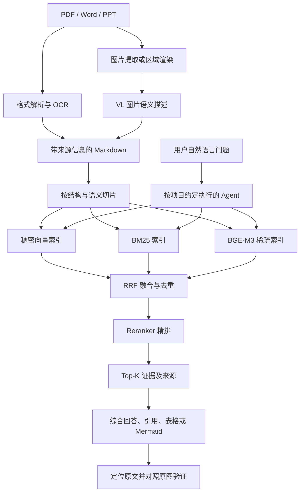

# 基于 AI Agent 的个人本地多模态文档智能问答系统：实验方案

本方案依据 `exprequirements` 目录中的 11 张 PPT 照片整理。照片包含系统介绍、架构、实施路径、模块设计、效果演示，以及开发方法和运行度量两张补充材料。这里按实验依赖关系重新组织，不能据此断言原始 PPT 的页码顺序。

**最新实施范围：** 按后续要求，当前实现分为 doc2md、DocBase、AGENTS.md 开发、Service 与 B/S Web 整合四个阶段。详细资源、工具、流程、预期效果和验收见同目录《四阶段实现细化方案.md》。下文课件“可选”标记描述的是原始 PPT 范围；Service 与 Web 已纳入当前计划。

**范围说明：**“PPT 明确”表示照片中能够读到的要求；“建议”表示为形成可执行、可验证的实验而补充的设计，不是老师已给出的硬性要求。遮挡、出框和模糊内容不作完整转录。照片中的 AGENTS.md 示例属于待开发系统的设计素材。

## 一、实验主题与目标

**实验名称：基于 AI Agent 的个人本地多模态文档智能问答系统。**

用户只记得某段内容，却忘了文件名、存放目录或页码。系统需要从本地 PDF、Word、PPT 文档中找到相关文字和图片信息，综合回答问题，并提供能够回到原文的出处。

PPT 的核心路线是：**doc2md × DocBase × AGENTS.md**。

1. **doc2md：让图文知识可检索。** 文档转为结构化 Markdown；提取图片并生成视觉语义描述；保留文件、页码、图题和原文链接。
2. **DocBase：让相关证据可召回。** 对 Markdown 切片，建立稠密向量、BM25、BGE-M3 稀疏检索，经过 RRF 融合和 Reranker 精排输出 Top-K 证据。
3. **AGENTS.md：让 Agent 知道何时、如何使用知识库。** 约定先检索、必要时补充检索、基于证据回答、附带引用，并在流程类问题中生成可与原图比较的 Mermaid 图。

实验需要验证：图片释义是否补充了纯文本检索遗漏的知识；混合检索与精排是否改善证据检索；明确的 Agent 约定是否提高检索执行和引用完整性。

注意：“个人本地”明确描述文档和知识库的使用场景，**照片并未证明模型推理全部离线运行**。是否调用远端模型接口，需在实际实现中记录。

## 二、PPT 的合理阅读顺序

下表使用文件名前缀，完整索引见《照片内容与顺序.md》。

| 顺序 | 照片前缀 | 主题 | 在实验中的作用 |
|---|---|---|---|
| 1 | 3974D90A | 项目标题与摘要 | 明确问题、目标与技术栈 |
| 2 | 405E5F93 | 系统总体架构 | 理解解析层、知识库层、Agent 消费层 |
| 3 | 7BF18301 | 五步实施路径 | 区分基础必做与选做扩展 |
| 4 | C24B928A | doc2md 多模态文档解析引擎 | 实现文字、图片释义与溯源 |
| 5 | 2A997E8E | DocBase 三路混合检索 | 实现入库、检索和检索自测 |
| 6 | 35346282 | AGENTS.md 知识消费约定 | 组织 Agent 的检索与问答行为 |
| 7 | 55E0A464 | DocQA 开发视图 | 明确目录、接口、依赖与测试边界 |
| 8 | E3A5CDAC | 示例一：语义检索、精准命中 | 验证不知道文件名也能找到答案 |
| 9 | 72C91735 | 示例二：多模态问答、图文互证 | 验证图片知识检索与流程图重绘 |
| 补充 A | DFA60601 | Claude Code + Conductor 开发流程 | 参考开发和人工审查方式 |
| 补充 B | 96FD0267 | CodeWiki 部署实践：度量 | 借鉴运行指标，不直接视为本实验必做项 |

## 三、实验范围与成果

### 3.1 基础必做：完成前三步闭环

PPT 明确：doc2md、DocBase、AGENTS.md 三项构成核心闭环。

| 模块 | 必须实现的行为 | 可检查产物 |
|---|---|---|
| doc2md | PDF/Word/PPT 转 Markdown；图片提取与 VL 释义；保留来源关系 | Markdown、图片文件、来源清单、解析日志 |
| DocBase | 语义切片；三路召回；RRF；精排；build/query/test；多文档与分类 | 持久化索引、查询结果、检索评估报告 |
| Agent 约定 | 声明知识库；规定查询策略、引用和输出形式；支持不足时补检 | 约定文件、问答记录、引用、Mermaid 示例 |

建议同时支持单文件和目录批量处理，提供命令行入口，能够从原文档重新构建并复现实验。

### 3.2 第四阶段：系统整合（原课件选做，现已纳入）

PPT 明确的第四、第五步是：

- **后台 Service：** 定时或增量更新指定目录和文档类型；管理文档、索引和图片解析；支持新增监控目录、单文档解析和递归搜索。
- **B/S Web 应用：** 提供图形问答界面，后台调用 CodeAgent 无头模式，显示回答、图形及原文出处。

前三阶段先通过命令行完成验收，第四阶段整合这两项，完成后台自动更新和浏览器问答闭环。

## 四、实验环境与数据准备

### 4.1 环境和模型能力

PPT 使用 Python 工程，模型服务分为四类。以下名称按照片记录，**尚未验证实际接口、访问权限或可用性**：

| 能力 | PPT 写出的模型/组件 | 用途 |
|---|---|---|
| 视觉语言 VL | Qwen3.6-27B-VL | 理解流程图、架构图、时序图等图片 |
| Embedding | Qwen3-Embedding-8B | 文档切片与查询的稠密向量表示 |
| Reranker | Qwen3-Reranker-8B | 对召回候选做相关性精排 |
| Chat | GLM-5.1 | 综合证据、回答、生成结构化结果 |
| 学习型稀疏检索 | BGE-M3 | 与稠密向量和 BM25 形成三路召回 |
| 编程/执行 Agent | CodeAgent，照片举例 Claude Code、NGA | 辅助开发及按约定调用知识库 |

建议将接口地址、认证、模型标识、超时和重试配置化。先用少量样本验证真实服务，单元测试使用 Mock；不要依据模型名称推断本机显存需求。

### 4.2 数据集

建议先准备 **12～20 份经过授权使用的文档**，覆盖 PDF、Word、PPT 三种格式，并包含原生文本、扫描页、流程图、架构图和表格。格式相同不代表解析难度相同，应分别记录。

每份文档建立清单：`doc_id、文件路径、格式、类别、版本、文件哈希、页/幻灯片数`。页数和图片数以实际统计为准。

建议预先建立 **60 道评测题**，分为 20 道调参题和 40 道冻结测试题；两部分均包含：

- 精确名词、接口名或命令查询；
- 不出现原文关键字的语义改写查询；
- 必须综合多个位置或多份文档的问题；
- 答案关键关系只存在于图片中的问题；
- 知识库无法回答的问题。

每道题人工标注：问题、类型、标准答案要点、相关文档、页码/幻灯片号、图片或证据段落、是否可回答。图片题需要先人工核对原图，不能用模型生成结果充当唯一标准答案。冻结测试集只在方案确定后使用。

当前目录的 PPT 照片是本方案的需求来源；其他 PDF 是否用作实验数据应另行选择，不能仅凭文件位于同一目录就自动全部入库。

## 五、技术路线与详细步骤



### 步骤 1：完成 doc2md 多模态解析

**PPT 明确的流程：** 多格式输入 → 格式转换 → 图片提取 → VL 释义 → 图片描述写入 Markdown → 结构化输出。

具体实施：

1. 解析标题、正文、列表、表格等结构，保存段落的来源位置；扫描页或文字型图片通过 OCR 提取文字。
2. 提取位图；矢量图先渲染为位图再处理。对由多个形状组成的图，必要时渲染整页/整张幻灯片，避免拆散节点和箭头。
3. 调用 VL，描述图中的对象、模块、方向、条件、分支、编号及异常路径。清楚区分“图上可见内容”和“解释性推测”，不可读的标注应显式保留为不确定项。
4. 将描述插入原图所在上下文，保留原图链接、来源文档链接、页码、图序号/图题，避免将所有图片释义堆在文末。
5. 输出 Markdown、图片目录、来源映射和失败日志。

PPT 展示的图片命名模式为“文档名_Page图片序_Figure标题”。建议在此基础上加入稳定的文档和图片 ID，解决重名、无图题和文件名字符不合法的问题；元数据应独立保存，不能只依靠文件名恢复来源。

建议每个图片块保存以下信息：

```json
{
  "doc_id": "doc_001",
  "source_path": "原始文档路径",
  "page": 12,
  "figure_id": "fig_002",
  "figure_title": "原图标题或空值",
  "image_path": "images/doc_001_p12_f02.png",
  "description": "经核对的图像语义描述",
  "description_model": "实际调用的模型标识"
}
```

上述页码仅为示例。PDF 页序号与印刷页码可能不同，应分别保存；PPT 记录幻灯片号；Word 页码与渲染环境有关，建议同时保存标题路径/段落锚点，若需稳定页码则保存对应渲染副本。

**本步验收：** 三种格式均可处理；抽查正文和图像释义；至少选择一幅流程图核对节点、箭头方向、分支条件和主备关系；每条来源记录都能定位原文。错误或无法解析的内容须进入日志。

### 步骤 2：完成 DocBase 检索引擎

#### 2.1 build：切片与建库

1. 按标题和语义结构切片，保留表格与图片说明的完整性；切片携带文档、类别、页码、图片 ID 和 Markdown 位置。
2. 建立 Qwen3-Embedding-8B 稠密向量索引。
3. 建立 BM25 词项索引，注意中英文、缩写、下划线和接口名的保留。
4. 使用 BGE-M3 的稀疏表示建立第三路索引，避免把普通关键词检索重复命名为第三路。
5. 本地持久化，并显示文档处理、切片、编码和索引阶段的进度与失败数。

**建议初始参数：** 每片约 400～800 tokens，相邻重叠约 80～120 tokens，最终以所选 tokenizer 计数。结构完整性优先，超长表格或图片描述采用带来源关系的子片。所有实验记录实际参数。

PPT 要求增量更新。建议以文件哈希判断内容变化，更新时同步清除旧切片及三路索引记录，明确处理删除、重命名和重复文件，防止新旧证据并存。

#### 2.2 query：三路召回、融合、精排

1. 根据问题与类别过滤检索范围；语义问题利用向量匹配，技术名词重视 BM25，但完整方案保留三路召回。
2. 三路独立召回候选，用统一 `chunk_id` 合并来源。
3. 采用 RRF 融合排名，避免直接相加不同检索器的原始分数。
4. 去重后交给 Reranker，返回 Top-K 文本和来源信息。

建议起点：每路召回 30 条，RRF 参数 `k=60`，融合后保留最多 50 条精排，最终输出 5～8 条。以上均为待调参数，不是 PPT 指定数值；需要在调参集上确定后冻结。

可采用的 RRF 定义为：`RRF(d) = Σ_i 1 / (k + rank_i(d))`，排名从 1 开始，未召回的路线贡献为 0。实现中固定并记录该约定。

#### 2.3 test：检索自测

输入带人工证据标注的问题集，输出每题各路候选、融合排名、精排结果和检索指标。保留中间结果，以区分问题发生在解析、切片、召回、融合还是精排阶段。

**本步验收：** build/query/test 三种模式均能独立运行；支持多文档、类别过滤和持久化重载；查询结果带来源；至少完成一次增量更新验证。

### 步骤 3：编写约定并接入 Agent

PPT 强调：知识库的存在不会自动保证 Agent 使用它，需要项目指令明确告知其存在、用法和边界。

建议约定文件至少包含四类内容：

1. **存在性声明：** 项目提供 DocBase 知识库，涉及库内文档的问题须先检索后回答。
2. **查询策略：** 识别类别和意图，拆解复杂问题，保留术语并尝试语义改写；证据不足时补检。
3. **溯源要求：** 重要结论附文档名、页码/幻灯片号、图号和可用路径；引用须支持具体结论；证据不足时说明缺口。
4. **输出形式：** 普通问题给答案与出处；对比问题用表格；流程问题按需生成 Mermaid，同时给出原图位置供核验。

把真实可执行的 DocBase 命令或工具接口、参数和返回格式写入约定，不能只写“请查询知识库”。不同 CodeAgent 的约定文件加载方式应在实际环境中验证；照片同时出现 AGENTS.md 和 CLAUDE.md，不能据此假设所有 Agent 自动加载同名文件。

建议问答流程：接收问题 → 意图分析与查询拆分 → 检索 → 检查证据覆盖 → 必要时再次检索 → 综合回答 → 输出引用与结构图。建议最多 3 轮检索，达到上限仍缺证据就说明不足；记录每轮查询和新增证据。

**本步验收：** 用户不提供文件名或目录，也能通过内容提问；日志证明调用过检索；答案引用可核对；无答案题不编造；流程问题能生成可渲染、可核验的图。

## 六、工程组织与接口

PPT 建议工程按职责分层，数据与约定分离，上层依赖下层，避免反向依赖。可按下列结构组织：

```text
docqa/
  doc2md/       # 解析器、图片提取、VL 客户端、数据模型
  docbase/      # 切片、索引、检索、评估、数据模型
  agent/        # 问答流程、Chat 客户端
  service/      # 可选：监控与增量更新
  web/          # 可选：Web 入口
  tests/        # 解析、检索、问答及端到端验证
  configs/      # 建议补充：不含密钥的配置模板
  data/         # 建议补充：原文、Markdown、图片、索引分区
  reports/      # 建议补充：评测结果和日志
  AGENTS.md     # 或实际 Agent 支持的约定文件
```

照片列出的核心接口如下，作为设计草案；实际参数类型和返回对象需在实现前明确：

```text
doc2md:
  parse_document(src, out, vl_ep)
  batch_parse(dir, recursive, types)

docbase:
  build_index(md_dir, incremental)
  query(index, q, top_k, category)
  eval_retrieval(index, test_set)

agent:
  answer_question(q, index, max_rounds)

service / web（可选）:
  register_watch(cfg)
  update_single_doc()
  handle_query(req) -> WebQueryResponse
```

建议问答返回结构包括 `answer、citations、rounds_used`；每条引用包含 `chunk_id、doc_id、source_path、page/slide、figure_id`。模型调用统一封装，以便真实服务与 Mock 替换。具体函数名不是外部工具已经存在的证明。

## 七、实验设计与评估方法

### 7.1 核心演示用例

**演示一：不知道文件名的内容检索。** 用户只描述想了解的技术内容，不输入文件名或目录。系统输出答案、相关图/表与来源，再实际打开对应文档验证。

**演示二：图片流程检索与重绘。** 选择包含流程图的技术文档，提出“请描述分组转发流程”一类问题。系统应通过入库的图片释义找出证据，说明流程并生成 Mermaid，与原图并排核验。

PPT 的示例涉及 UNI 子卡、CXP 内部 MAG/NP/TM、USI 表及主备哑板等角色；核验重点是箭头方向、查询主备状态、处理顺序，以及主备路径差异。这些角色来自演示图，**不要求实验数据必须属于通信领域**。若无法取得对应原文，可用另一幅关系明确且有人工标准答案的流程图替代，并说明替代情况。

### 7.2 对照与消融

下列分组是建议补充，PPT 没有规定统一分组。检索实验使用同一文档集、切片规则、题集和最终 K；问答实验固定 Chat 模型、提示主体和预算，保留实际检索参数。

| 实验 | 分组 | 目的 |
|---|---|---|
| 图像信息消融 | 仅正文+OCR；正文+OCR+VL 图像释义 | 比较图片题的召回与回答正确性 |
| 检索消融 | 稠密向量；稠密+BM25；三路+RRF；三路+RRF+精排 | 衡量各检索阶段的贡献 |
| Agent 约定消融 | 相同工具可用，仅移除知识库专用约定；加入完整约定 | 比较先检索比例、引用完整性及正确率 |
| 多轮检索消融 | 仅一轮；最多三轮 | 衡量补检收益与时间/Token 代价 |

不用一次执行全部组合。建议先完成完整系统，再逐项关闭一个能力，避免同时改变多个因素而无法解释结果。Agent 约定消融中保留格式、安全和工程通用说明，只移除知识库专用条款。

### 7.3 指标定义

| 层次 | 指标 | 建议统计口径 |
|---|---|---|
| 解析 | 正文完整性、图像覆盖率 | 人工标注的应提取内容中，成功提取的比例 |
| 图像理解 | 节点、关系、条件准确性 | 与原图人工标注比对，分别记录遗漏和新增错误 |
| 检索 | Recall@K | Top-K 找到的相关证据单元数 / 人工标注相关证据单元总数，再按题平均 |
| 检索 | Hit@K | 至少命中一个相关证据的问题数 / 可回答问题数 |
| 检索 | MRR@K | 首个相关结果排名的倒数，K 内未命中记 0，再按题平均 |
| 问答 | 答案要点得分 | 每题按标准要点评为 0/1/2 分：错误或缺失、部分正确、完整正确 |
| 引用 | 引用支持率 | 被其引用证据实际支持的已引用结论数 / 已引用结论数 |
| 引用 | 关键结论引用覆盖率 | 具有有效证据引用的关键结论数 / 应引用的关键结论数 |
| 溯源 | 来源定位成功率 | 可准确定位原文页/图/段落的引用数 / 引用总数 |
| 无答案 | 正确拒答率 | 正确说明证据不足的无答案题数 / 无答案题数 |
| Agent | 检索执行率 | 按约定应检索且实际调用检索的问题数 / 应检索问题数 |
| 性能 | 耗时、Token、轮次 | 建库耗时、每题端到端耗时、中位数/P95、实际返回的 Token 使用量和检索轮次 |

检索的相关性建议按稳定的“文档+页/图/段落”证据单元标注，再映射到 chunk；重叠切片命中同一单元时只计一次。知识库无法回答的问题不计入可回答题的 Recall、Hit 和 MRR，单独计算拒答。自动评分可辅助，但最终演示及争议样本应人工核验。

### 7.4 验收标准

**来自 PPT 的功能验收：** 三种文档格式解析、图片释义入 Markdown、可溯源、三路检索与精排、build/query/test、Agent 按约定检索与回答、图文互证。

**建议的量化目标（实验前确定，不能作为既有成绩）：**

- 在冻结测试集中，可回答题 Hit@5 达到 85% 以上；
- 关键结论引用覆盖率达到 90% 以上；
- 演示用例中的来源定位全部成功；
- 无答案题正确拒答率达到 80% 以上；
- 完整系统相对基线的差异按题型报告；没有提升或出现退化时如实分析。

这些数值仅是起始目标，样本较少时必须同时报告分子/分母；性能阈值需在实际硬件和模型服务上测定。PPT 中“人工查找 10～30 分钟，系统约 30 秒”的表述只是演示页的对比，未给出测量条件，不能直接写成本实验实测结论。

## 八、实施安排与开发方法

当前按四个实现阶段安排，周期可按课程要求调整；需求、样本和模型连通性在第一阶段开始时落实：

| 阶段 | 主要工作 | 完成条件 |
|---|---|---|
| 1：doc2md | 准备样本及接口；三种格式、OCR、图片提取、VL 释义、来源映射 | 产出可核对的 Markdown 与结构化内容块 |
| 2：DocBase | 切片、三路索引、融合、精排、增量、评测 | 三种运行模式完成，产生检索评估报告 |
| 3：AGENTS.md | 接入 Agent、编写约定、多轮检索、引用、Mermaid | 两类核心演示及问答评估完成 |
| 4：系统整合 | 后台监控与自动更新、任务运维、B/S Web、整体验收 | 浏览器完成问答与来源定位，自动更新及恢复可验证 |

开发方法可借鉴照片中的 SPEC/PLAN → 实现 → 用例设计 → 测试 → 评估修正流程：

1. 人工先检查模块需求与接口是否完整；
2. 实现后检查代码是否满足约定；
3. 检查测试用例本身能否发现错误，避免只得到表面的 PASS；
4. 将解析、检索、Agent 分层验证后，再做端到端集成。

补充照片标题为“十步流程”，但当前照片只清楚展示部分编号，不能据此还原完整十步。Conductor 是照片里的开发实践示例，是否使用取决于现有环境，不影响系统核心验收。

## 九、应提交的实验材料

1. **源代码与运行说明：** 环境、配置模板、解析/建库/查询/测试入口；不包含真实密钥。
2. **需求和设计：** 模块职责、数据结构、接口、依赖关系和项目约定文件。
3. **解析成果：** 样本文档的 Markdown、图片及释义、来源映射、失败记录。
4. **知识库成果：** 索引或重建说明、实际模型版本和参数、增量更新记录。
5. **测试材料：** 调参集与冻结测试集、人工标准证据、各组逐题结果及汇总指标。
6. **演示材料：** 无文件名语义检索案例、图片流程重绘案例、真实来源定位截图。
7. **实验报告：** 目标、方案、环境、数据、结果、消融比较、典型失败和改进方向。

运行度量可参考 CodeWiki 补充照片：访问/活跃用户、Token、响应时延、并发/队列、用户反馈和采纳情况。它们适合 Service/Web 扩展；单人基础实验先记录耗时、Token、轮次和正确性即可。截图中的 236 人次、82,683 tokens 等数字属于原演示界面，不是本实验数据。

## 十、开始实现前需核实的事项

- 实际可用的模型接口、权限、费用/额度与数据传输要求；照片中的模型名称仅代表课件配置。
- 是否能访问课件展示的内部代码仓库及具体版本；本方案未访问这些地址，也不假设已获取代码。
- 原始要求是否另有提交日期、评分标准和指定数据集；照片中未见完整说明。
- 后台服务和 Web 页面已按后续要求纳入第四阶段；具体页面、API 和运维范围见细化方案。
- 可使用的源文档、图像及人工标准证据。

这些事项不妨碍先按前三步开展原型设计，但会影响最终模型配置和验收范围。
