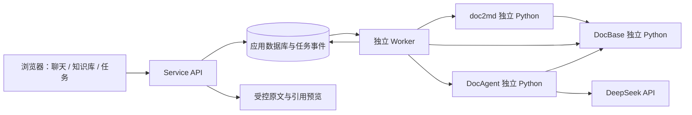

# 第四与第五阶段细化方案：Service 整合与知识库聊天 Web

日期：2026-10-29。本文是待执行的开发方案，未表示后台、网页、删除接口或多轮会话已经实现。

实施状态更新（同日）：本机首版已构建并启动，见`../ResearchDesk/README.md`和`../ResearchDesk/验证记录.md`。已交付知识库管理、上传/离线入库、移出恢复、空索引、聊天接入/偏好/历史、引用预览、持久任务、目录监控及备份恢复。以下正文保留方案基线；多人、永久文件清除、Token流和原图模型核验仍属扩展，新增真实网页模型问答尚待启用对应库外部处理后检查。

按最新要求，将原第四阶段拆成两阶段：**第四阶段负责后台 Service、任务运维与前三阶段整合；第五阶段负责 B/S Web、知识库自主管理与个性化 Agent 聊天**。既有前三阶段目录与独立环境继续使用，不合并重装。

## 1. 产品目标与交付范围

暂定产品名为“研知 / Research Desk”，可在实施时更名。产品围绕“提出研究问题 → 找到库内证据 → 阅读并核验来源”组织，登录后/打开后首先进入聊天，而不是统计仪表盘。

### 首版必交付

- 浏览、新建、重命名知识库；查看文档、检索内容、上传、移出知识库、恢复移出的文档。
- 预览原文 PDF、解析 Markdown 和已有图片释义；显示来源、解析质量与入库状态。
- 持续聊天：历史会话、新建/重命名/删除会话、追问、停止、重新生成、复制与导出。
- 按当前选定知识库自主检索，必要时补检和补取上下文；回答带可点击引用。
- 用户可配置回答语言、长短、研究方向、表达方式、引用偏好；保存到个人设置，可按会话覆盖。
- 任务中心：上传/解析/建库/问答进度、失败原因、取消、重试、服务重启恢复。
- 本机启动与停止、数据备份/恢复、运行日志及模型连接诊断。

### 分批交付的扩展

首版为**本机单用户应用**，但数据表保留owner_id。局域网多人模式、邀请与权限、跨多个知识库联合检索、真正的逐字模型流式输出、自动原图核验、复杂工作流及云部署后续扩展。

“网页用户”在首版指本机应用的使用者，并不等于已实现多人隔离。未完成身份认证和资源授权前，只监听127.0.0.1，不开放到公网或局域网。

## 2. 已有基础与真实缺口

| 模块 | 已有能力 | 仍须整合/扩展 |
|---|---|---|
| doc2md | parse、批处理报告、Markdown/blocks/manifest、图像释义、来源快照 | 上传接入、任务事件、按文件取消与重试、服务托管目录 |
| DocBase | scan/select/build/query/get/context/status、版本化索引与来源存储 | 正式移出/恢复入口、空库索引、集合操作、历史引用访问策略 |
| DocAgent | deepseek-flash、规则加载、工具调用、补检、引用校验、JSON/MD/trace | 会话上下文、个性化配置、进度事件、受控子进程入口、多轮评测 |
| 本地数据 | Zotero集合33篇，索引使用bm25-only，源解析为partial | 历史数据登记、用户可见状态、检索质量继续改善 |

真实运行run_697316967bfe4925bfd2已返回answered，耗时22.359秒，使用deepseek-flash，说明单轮检索问答链路已跑通；不据此宣称多轮聊天或整个知识库质量已验收。

最近问题包括：中文初检命中无关论文、方法正文/公式未进入候选、引用与推断的语义支持仍需人工检查。新网页必须如实展示“仅检索到部分证据”，不能用漂亮页面掩盖缺口。partial不等于某章节必然没有入库。

## 3. 整体结构与目录



建议新增一个与前三项目并列的ResearchDesk：

```text
大模型软件开发/
  doc2md/                       原环境、原配置
  DocBase/                      原环境、原配置
  DocAgent/                     原环境、原配置
  ResearchDesk/
    service/
      .conda/                   第四个独立Conda环境
      .env / .env.example       服务路径、端口、任务并发等；不复制模型Key
      src/researchdesk/
        api/                    HTTP路由、请求验证、资源访问
        workers/                队列、租约、调度、进程管理
        adapters/               三个已有项目的子进程适配
        repositories/           数据库与事务
        chat/                   历史编排、偏好、事件
        sources/                原文/Markdown/图像的受控映射
        maintenance/            备份、恢复、清理、健康检查
      tests/
    web/
      src/app/                  路由、应用外壳
      src/features/             chat、libraries、documents、jobs、settings
      src/components/           按钮、表格、引用、预览等
      src/styles/               瑞士风格设计变量与排版
      package.json / lockfile
    data/
      app.sqlite
      uploads/                  网页上传的托管原文
      parsed/                   服务新解析产物
      catalogs/<kb_id>.json
      runs/<run_id>/
      logs/
      backups/
    design/                     设计说明、截图、验收记录
    start.cmd / stop.cmd / status.cmd
    README.md
```

首次整合继续使用DocBase现有storage，保护既有索引和source_store；不立即搬迁。服务数据库只登记引用与映射。若以后迁移，逐项验证哈希与引用后切换，不以移动目录作为集成前置。

生产模式由Service同源提供web构建文件与/api；开发模式Vite代理/api到后端。浏览器不接触Conda和本地模块路径。

---

## 4. 第四阶段：后台 Service 与流程整合

### 4.1 所需资源和工具

| 类型 | 选型 | 用途 |
|---|---|---|
| Python环境 | 独立Python 3.11 Conda前缀 | API、任务与适配层；不改动前三个环境 |
| API | FastAPI、Uvicorn、Pydantic | 数据验证、HTTP接口、同源静态资源 |
| 持久化 | SQLite WAL模式、SQLAlchemy、Alembic | 业务数据、任务与版本迁移；数据库限本机磁盘 |
| 执行队列 | SQLite持久任务表＋独立Worker进程 | 重启后保留任务；按租约领取、心跳与恢复 |
| 目录变化 | 定时扫描与防抖；watchdog作为可选加速 | 发现新增/变化，定期全量校验弥补事件丢失 |
| 进程管理 | subprocess、Windows Job Object适配 | 三个模块进程隔离、超时/取消及防止孤儿进程 |
| 日志与检查 | 结构化JSON日志、pytest、API集成测试 | 请求与任务追踪、故障回归 |
| 系统启动 | CMD启动脚本；Windows任务计划程序为可选托管 | 本机启动、停止、重启与开机运行 |

不将解析/建库/问答长任务仅放在FastAPI请求进程的BackgroundTasks中。采用持久任务和Worker，API返回任务ID后即可结束请求；这也是对长时独立执行任务的工程选择。[FastAPI后台任务说明](https://fastapi.tiangolo.com/tutorial/background-tasks/)

首版无需Redis、Celery、Docker或向量数据库服务。以后确有并发和跨机需求，再替换队列与数据库，保持任务和API契约。

### 4.2 数据模型

| 表/实体 | 必要字段与约束 |
|---|---|
| users/settings | 首版固定本机owner；语言、长度、研究方向、引用偏好；不保存明文模型Key到前端可访问字段 |
| knowledge_bases | kb_id、owner_id、name、内部collection、状态、期望内容代次desired_generation、已发布代次published_generation |
| documents | document_id、owner_id、原名、文件类型、SHA、托管路径、来源类型、大小、创建时间 |
| kb_documents | kb_id、document_id、membership状态、关联doc2md doc_id、active_revision、artifact_id、期望操作代次 |
| document_revisions | revision、解析配置、产物、质量状态、警告、解析时间；不把换文件名当换正文版本 |
| index_versions | kb_id、index_version、构建输入代次、profile、状态、发布时间 |
| jobs | job_id、类型、幂等键、状态、stage、attempt、父任务、租约、心跳、请求ID、取消标志、错误码 |
| job_events | job_id、递增event_id、事件类型、时间、可展示payload，用于SSE补发 |
| conversations/messages | 会话、消息、分支、角色、顺序、状态；user消息与每个assistant attempt分别存储 |
| runs/citations | 模型、collection、版本、策略哈希、偏好快照、usage、引用证据与可访问资源ID |
| source_assets | asset_id、owner、关联版本、受控真实路径、类型、哈希、状态与历史保留策略 |
| watches | 服务端登记根目录、目标kb、周期、成功扫描时间、防抖、监控状态 |

kb_id是业务稳定标识；内部collection使用安全ID，不由可重命名的知识库名称拼接。一个物理文档可属于多个知识库，移出其中一个不能删除其他知识库的文档。

### 4.3 上传、解析、入库流程

1. 浏览器选择文件，显示格式和大小限制，初版建议单文件≤100MB、单批≤20个，均为可配置值。
2. Service分块接收至临时文件，限制大小，核对扩展名与实际文件签名；上传完成原子归档至uploads，生成SHA。拒绝路径穿越、伪装类型和未支持格式。
3. 相同知识库内同SHA文件默认复用，返回“已存在”；同内容跨库可复用解析产物但分别登记成员关系。不同解析配置不能误用旧产物。
4. 写入文档关系与持久任务，返回202和job_id；进程崩溃时临时上传可按规则清理。
5. Worker调用doc2md独立解释器，输出到每任务独立目录，避免共享batch_report.json相互覆盖。
6. 以落盘batch_report/manifest为依据，核对本次输入SHA、输出路径、状态与配置；第三方PDF库打印到stdout的提示不能被当作协议JSON。
7. 成功或partial且有有效内容时登记产物，生成该kb的候选catalog。失败文档可保留在列表并重试，不进入有效索引。
8. 对同一知识库的多个变更合并调度建库；锁定输入generation后调用DocBase build，使用context切片及明确profile。
9. 构建通过后发布完整索引；若期间desired_generation已变化，记录当前发布落后，并继续构建下一代，不声称已完全同步。
10. 发布成功才标“可检索”；解析成功但等待建库显示“待入库”。失败时保留旧索引。

入库默认模式明确为bm25-only。视觉解析是否调用Qwen按库设置选择“完整解析”或“仅离线文本”，上传前展示；不因为后台自动化就悄悄切换付费模型或重试无限次数。

### 4.4 删除、移出、恢复与空库

用户界面把两种操作区分为“移出知识库”和“彻底删除托管文件”。首版优先交付前者，后者放入回收站管理并需明确确认。

**移出流程：** 标记kb_document为removing并提交新generation → 新问答的检索可见性立即排除该成员 → 构建不含该文档的索引 → 发布完成后显示removed。构建失败显示“已停止用于新问答，索引清理失败，可重试”，不能假报成功。

仅修改页面列表不够；仅改catalog也不够。计划为DocBase增加正式`exclude/restore`入口，校验集合、文档和catalog并记录操作。现有scan不会自动删除旧登记，不能把重新scan当成删除实现。

**立即排除的技术补充：** DocBase query新增运行时allowed_doc_ids过滤，过滤发生在候选召回前；Service按会话授权和当前成员关系给出允许范围，模型无权扩大。删除事务提交后新创建的run使用新可见性代次；已经运行的旧run取消并丢弃未交付结果，客户端清除临时内容。删除前已交付的历史答案按历史策略保留，不把它伪装成新查询结果。

**最后一篇被移出：** 当前DocBase会对空catalog报EMPTY_CATALOG。必须新增可发布的empty快照，query返回成功且results=[]，而不是继续使用旧CURRENT；这是第四阶段验收必测项。

**历史引用：** 默认移出仅影响未来检索，保留旧回答绑定的快照，提示“该文档已移出当前知识库”。彻底清除时显示会影响的历史回答/引用数量，撤销文件访问并清理无其他引用的托管副本；旧答案中的引文文本也属于数据，需纳入明确的清除范围。备份中的保留期限同时说明，不承诺已从所有备份瞬间消失。

**原始Zotero文件：** 仅登记和读取，不因网页移出/清除而删除Zotero/storage原件。跨库共享source_store仅在引用计数为0、无运行任务和保留期到期后可清理。

### 4.5 任务调度与自动运维

任务状态统一：queued → running → succeeded / partial / failed / cancelled；进程丢失记interrupted，等待显式或受限自动重试。业务“证据不足”与技术任务失败分开。

阶段事件包括uploaded、parsing、parsed、indexing、published、retrieving、composing、validating。不能按等待时间伪造百分比；未知总量时显示阶段和已完成页/文件数。

- 首版默认解析并发1、同库建库并发1、问答并发2；全局限流，防止模型请求和内存相互抢占。
- Worker通过数据库事务领取任务，持有租约并续约。旧Worker写结果必须携带fencing token，过期租约的迟到结果不得覆盖新任务。
- 幂等键包含kb、文档SHA、解析配置、操作代次。重复点击与重试不会重复入库。
- 设置有限重试与退避；认证、余额、格式不支持不自动反复重试。问答发生未知网络结果时不自动整轮重放，以免重复计费。
- 取消标志落库，Worker终止受控子进程树并回收临时产物；原子发布后的任务取消不能逆转已发布事实，应显示实际完成状态。
- 监听目录先检测可达性和稳定文件大小，再读文件；目录掉线不等于全部文件被删除。默认发现外部删除只提示，不自动批量移出。
- 重启扫描过期租约，恢复未完成阶段；只清理本服务登记的孤儿任务/临时目录，不清理任意Python进程或目录。
- /health只做无模型成本检查；模型probe由用户触发或明确配置低频计划，不把频繁计费探测当健康检查。
- SQLite在线备份配合不可变文件清单和哈希；恢复演练包括会话、目录映射、CURRENT与引用。清理前先做可解释的预览。

### 4.6 持续聊天与个性化接入

当前AgentRunner.ask只接单轮question；Service不得仅保存聊天界面就宣称具备多轮理解。需要扩展DocAgent的受控ChatRequest：

```text
question + recent_messages + conversation_summary + preferences
         + collection + allowed_doc_ids + fixed_index_version + visibility_generation
```

处理顺序：用户消息持久化 → 锁定当前资料范围与偏好快照 → 在DocAgent环境中启动run → 结合历史理解追问 → 本轮重新检索/校验证据 → 提交最终答案 → 将回答与引用持久化。

- “它的消融实验呢？”应依据最近明确讨论的论文解析代词，但必须重新查证；历史assistant内容不能成为新的原文证据。
- 新一轮默认使用最新已发布索引，每轮固定版本；知识库更新时标明本轮版本变化。也可由用户锁定会话版本。
- 初版每会话绑定一个知识库，可在库内选多个文档。切换知识库新建会话或新分支，避免前文跨库事实混入。
- 近期上下文以实际预算截取，较早内容生成可查看/重置的摘要；摘要不能替代证据，删除会话时同步删除摘要。
- 用户偏好支持“中文/英文、简洁/详细、背景水平、研究方向、先结论/先解释、保守回答”。只注入白名单字段及长度受限的用户说明，不允许覆盖系统规则、工具权限与引用要求。
- 偏好作用域为用户默认→会话覆盖→单轮要求；运行记录保存当时配置，后改偏好不回写旧回答。
- 首版不从论文或对话中偷偷推断长期个人画像。需要新增长期记忆时，给出可查看、修改、删除的条目与开关。
- 重新生成创建新的attempt，保留旧答案并让用户切换；避免覆盖引用。连续发送默认排队，分支编辑后续消息另存分支。

进程隔离：新增`DocAgent --request-file ... --events-file ...`受控入口，由其环境内部构造Runner。Service不在自己的环境直接import DocAgent，也不在进程间交替激活Conda。

### 4.7 API与事件契约（待实现）

| API | 行为 |
|---|---|
| GET/POST /api/knowledge-bases | 列表、新建 |
| PATCH/DELETE /api/knowledge-bases/{kb} | 重命名、回收知识库，说明历史影响 |
| GET /api/knowledge-bases/{kb}/documents | 分页、筛选、排序；返回入库/解析状态 |
| POST /api/knowledge-bases/{kb}/uploads | 上传并返回job_id/document_id |
| DELETE /api/knowledge-bases/{kb}/documents/{doc} | 移出，返回操作任务；不删除原件 |
| POST /api/knowledge-bases/{kb}/documents/{doc}/restore | 恢复关系并重新发布索引 |
| POST /api/knowledge-bases/{kb}/search | 只检索、不生成答案；可限定文档 |
| POST /api/knowledge-bases/{kb}/reindex | 手动重建，幂等提交 |
| GET/POST /api/conversations | 列表、新建；创建时绑定kb与初始偏好 |
| POST /api/conversations/{id}/messages | 写入用户消息并返回run_id/job_id，HTTP 202 |
| GET /api/conversations/{id}/messages | 历史消息、尝试与引用 |
| PATCH/DELETE /api/conversations/{id} | 标题/偏好调整、会话删除 |
| POST /api/runs/{id}/cancel | 持久取消请求 |
| GET /api/jobs/{id}、POST .../retry | 任务状态、受限重试 |
| GET /api/jobs/{id}/events | SSE阶段事件、最终状态与断线续传 |
| GET /api/sources/{asset_id} | 鉴权后受控访问PDF/图片/下载，支持PDF Range |
| GET/PATCH /api/preferences | 读取/保存个性化配置，不返回Key |
| GET /api/health | API、Worker、存储、索引的非计费健康状态 |

事件含event_id、job_id、run_id、type、created_at、payload。先POST提交，再GET订阅；使用同源Cookie/本机会话凭据，避免把Key放URL。支持Last-Event-ID和定期心跳，断线重连只补事件、不重复执行任务。[SSE说明](https://developer.mozilla.org/en-US/docs/Web/API/Server-sent_events/Using_server-sent_events)

首版流式展示**阶段进度**，最终答案引用校验通过后一次交付；不假装现有非流式客户端已经逐字输出。如果后续增加Token流，临时文本明确为草稿，校验失败撤回且不写成成功消息，最终以answer_committed事件为准。

### 4.8 配置、数据访问与用户授权

模型Key留在原项目服务端.env中，前端只显示“已配置/未配置”和连接检测结果。首版不做浏览器编辑Key功能；不将Key写入VITE_变量、日志、SSE或数据库明文返回。

来源访问使用asset_id映射，服务器校验用户、知识库/历史run及资源关系，拒绝任意绝对路径；Markdown移除原始HTML和危险链接，PDF/图片只从已登记目录输出。

上传/首次提问时用简洁设置说明：完整解析会把所需页面/图片发送至配置的Qwen服务；Agent会把问题和选中证据发送至DeepSeek。用户可选择离线解析、关闭外部问答或为指定库启用外部模型处理；选择持久保存并可撤回，拒绝时不在后台绕过。知识库文档本身不能改变此设置。

本机模式也需防止其他网页调用本机API：限制Host/Origin、状态变更请求的CSRF防护、本机会话凭据、上传限制。多人部署前为每个查询、下载、SSE和任务增加owner授权测试。

### 4.9 开发流程与验收

| 步骤 | 工作与产物 | 检验/预期效果 |
|---|---|---|
| S1 契约与底座 | 资源ID、数据库迁移、Service独立环境、health | 三个旧CLI仍可运行，数据库可创建/迁移 |
| S2 任务系统 | 持久队列、租约、进程树、事件 | API不被解析阻塞；重启任务记录不丢 |
| S3 上传入库 | 独立产物目录、adapter、catalog与generation | PDF上传后可检索；重复上传不重复计数 |
| S4 删除一致性 | exclude/restore、允许文档过滤、空索引 | 移出后新问答不引用；最后一篇移出变空库 |
| S5 聊天服务 | ChatRequest、多轮上下文、偏好、版本与引用 | 追问能理解对象，事实仍需重新取证 |
| S6 运维与交付 | 启停、扫描、备份/恢复、诊断 | 失败可重试；旧快照与引用不被误清理 |

必测：并发上传同一文件、同库边建库边删除、最后一篇删除、掉线目录、发布前崩溃、发布后取消、Worker租约过期迟到写、SSE断线续传、会话取消与立即再问、历史引用与彻底清除冲突。

阶段交付：可运行API/Worker、OpenAPI文档、模块适配器、数据库迁移、端到端测试、启停/恢复说明。此阶段可用API验收，不以完成网页作为后台正确性的替代。

---

## 5. 第五阶段：知识库管理与个性化聊天 Web

### 5.1 所需资源和工具

采用React＋TypeScript＋Vite，CSS变量实现自有设计系统；查询状态可使用TanStack Query，表单/校验按需选择，避免为简单页面引入多个状态框架。Markdown使用安全渲染，PDF预览使用PDF.js，代码高亮/公式/可选Mermaid按需加载。

开发和构建依赖锁文件固定版本。已知本机Node为22.13.1，**不直接假设兼容最新版Vite**：实施时核对所选版本engines，必要时安装独立适用Node版本或固定兼容版本，不覆盖用户既有环境。[Vite官方文档](https://vite.dev/guide/)

浏览器验收用Playwright及Chrome/Edge；taste skill用于设计推敲与截图审查。此方案采用应用界面规则，用户指定的瑞士国际主义风格优先，不随机替换为其他视觉风格。

### 5.2 信息架构

| 页面 | 首要问题 | 核心操作 |
|---|---|---|
| /chat/:conversation | 我的问题得到什么结论，证据在哪里？ | 提问、追问、查看引用、停止、重试 |
| /libraries | 我有哪些可用资料库？ | 新建、切换、重命名、查看内容 |
| /libraries/:kb | 哪些文档可用于检索？ | 浏览、搜索、上传、移出/恢复、限定范围 |
| /documents/:doc | 原文与解析结果可靠吗？ | 原文/Markdown/图片释义切换、重解析、质量详情 |
| /jobs | 哪些任务需要处理？ | 看阶段、取消、重试、查看简明错误 |
| /settings | Agent如何按我的习惯工作？ | 个人偏好、外部模型处理授权、连接状态 |

聊天历史放左侧常驻导航，知识库管理是次级入口；首次打开空库显示“上传资料”与“浏览已有知识库”，已有库则直接允许提问。用户无需先打开运维页面。

### 5.3 主聊天页面

桌面按“左侧会话导航 → 中间对话 → 右侧证据抽屉”组织。右侧默认折叠，点击引用展开，不永久挤压聊天正文。

```text
┌──────────────────────────────────────────────────────────┐
│ 研知 / Research Desk                当前知识库 · 连接状态 │
├─────────────┬───────────────────────────┬────────────────┤
│ 新建对话     │ 对话标题                  │ 证据 E1        │
│ 搜索历史     │ 当前库 / 范围 / 回答风格    │ 文件名 / 页码  │
│ 会话列表     │                           │ 原文短引文     │
│             │ 用户问题                  │ PDF预览        │
│ 知识库       │ Agent回答与就近引用        │ 来源类型/质量  │
│ 任务         │ 本轮检索状态 / 版本        │                │
│ 设置         │                           │                │
│             │ 输入框 / 发送或停止        │                │
└─────────────┴───────────────────────────┴────────────────┘
```

- 对话不采用彩色大气泡堆叠。用户问题用适度灰底/清晰角色标识，Agent回答用正文排版、段落与引用编号。
- 输入框支持中文输入法，Enter发送，Shift+Enter换行；composition状态下不误发送。支持上传入口，但聊天附件须先选择“本次临时资料”或“加入当前库”，首版先只交付后者，避免不明来源混入。
- 发送前可看到当前知识库与范围，默认“库内自主检索”；找不到证据时不自动切换网络搜索。
- 顶部个性化摘要只显示“中文 · 简洁 · 严格引用”等少量可操作设置，不暴露模型temperature等非必要实现细节。
- 过程显示“检索资料 / 补充上下文 / 组织回答 / 核验引用”，不显示隐藏思维链。
- 引用点击后显示原文短句、PDF文件页序号、来源类型、打开对应页/下载入口。图像未核验要明确，已生成释义与原图分开。
- answered、insufficient_evidence、failed使用不同表达；证据不足时保留可核实部分和建议查找范围，网络故障提供重试，不显示“资料里没有”。
- 自动滚动只在用户停留底部时跟随；用户向上阅读不被拉回。草稿本地保存与持久会话状态区分，刷新不重复提交。

### 5.4 知识库和文档管理

知识库列表采用文字与表格，不用大卡片展示每一篇论文。详情页表头显示名称、已入库数/总数、同步状态、上传按钮与内容搜索。

文档列包含文件名、类型、页数（未知显示—）、解析质量、入库状态、加入时间、行操作；提供分页/虚拟列表、名称筛选、格式/质量/状态筛选和排序。

上传抽屉提供拖拽/选择、逐文件进度、重复提醒、解析模式与外部处理设置。上传完成不立即显示“可问答”；清楚区分已上传、解析中、待建库、可检索、部分可用、失败。

移出前显示影响文档与范围；批量操作只作用于明确选中项，“本页全选”与“全部筛选结果”区分。操作后从服务端刷新状态，不用乐观删除掩盖后台失败。

文档预览采用PDF/Markdown/图片释义标签页，原生PDF按需加载；Office默认提供已生成PDF或下载，不保证浏览器能直接阅读DOC/PPT。Markdown中的相对图片经asset映射重写，不能把磁盘file://路径直接放到浏览器中。

知识库“内容检索”返回命中片段、文件与页，不自动生成答案；用户可选择“基于这些资料继续问”，进入新会话并锁定资料范围。

### 5.5 个性化设置

首版设置以可解释的用户选择为主：称呼（可选）、研究方向、背景水平、回答语言、简洁程度、先结论或先说明、是否展示推断、引用风格。默认中文、适中、关键事实带引用。

提供“本次会话覆盖默认设置”和“恢复默认”。更改偏好只影响下一轮；知识库范围、历史摘要、外部模型使用设置可随时查看。

不设计“关闭引用后仍当作有证据回答”的模式；用户可调节引用展示密度，关键论断仍保留证据记录。风格偏好不能改变事实核验与权限规则。

### 5.6 瑞士国际主义极简视觉规范

**设计主张：让问题、答案与出处共享一套可对齐的秩序。** 产品特征是“证据编号”和“资料页码”，将其作为视觉识别，而不是添加无关装饰图案。

| 元素 | 设计约定 |
|---|---|
| 色彩 | 白/近白#FAFAF7、墨黑#111111、辅助灰#666666、分隔线#D9D9D4；信号红#C62828作唯一主强调色 |
| 布局 | 桌面12列网格、24px沟槽、32px外边距；阅读区最大约800px，网格不等于所有区域平均分配 |
| 字体 | 中文优先本地托管Noto Sans SC或思源黑体；拉丁可采用Helvetica/Arial回退；数字使用tabular-nums |
| 层级 | 主界面标题24～32px，正文16～17px、行高约1.65；辅助信息12～14px；空会话可用48～64px大字，长对话不反复占屏 |
| 构图 | 左对齐、不对称分栏、明确基线；用大字号与细线/粗线的对比建立张力 |
| 组件 | 方角或2～4px圆角；无玻璃、无渐变、无浮夸阴影；表格用细线分隔，数字右对齐 |
| 强调 | 红色用于当前交互焦点、发送/停止状态和证据定位；删除用明确文字与警告图形，不只靠颜色区分 |
| 品牌 | “研知”字标＋由引文括号/页码刻度发展的小型几何标记；不直接套字母黑方块 |
| 动效 | 120～180ms展开/状态过渡；不做持续背景运动和逐字打字假动画；支持减少动态效果 |

视觉冲击来自比例、对齐、黑白对比及一处明确红色，而不是整页大红背景。知识库和聊天是长期使用的工作界面，内容可读性优先。

关键组件：扁平侧栏、文本页签、简洁表格、编号引用标记[E1]、可折叠证据面板、底部输入区、上传抽屉、操作确认对话框。所有状态同时有文字，焦点轮廓可见；普通文本对比至少4.5:1，按钮/图标有可读标签或无障碍名称。

### 5.7 响应式与交互边界

- ≥1280px：导航约224px，聊天居中；证据展开约360px，剩余宽度不足时采用覆盖抽屉。
- 768～1279px：会话栏可收起，证据覆盖，不强行三栏。
- <768px：单列聊天；导航与引用分别作为抽屉/全屏面板，输入框适配软键盘；主要触控目标≥44px。
- 390px宽不出现全页横向溢出。代码和表格可在局部滚动，长文件名省略并可展开。
- 加载有骨架与阶段文字；空库显示上传入口；断网说明回答任务可能仍在后台运行，恢复连接后续接而不重复发送。
- 删除/取消/重试/关闭预览均支持键盘，焦点返回触发控件；错误提示与对应表单字段关联。

### 5.8 开发流程、预期效果与检验

| 步骤 | 实现流程 | 预期效果与检查 |
|---|---|---|
| W1 设计系统 | 真实对象与状态清单、路由、网格/字体/颜色、静态布局 | 1440与390px外壳通过；瑞士风格明确且正文可读 |
| W2 聊天闭环 | 会话列表、输入、任务事件、最终答案、引用抽屉 | 能完成首问→追问→打开原文；刷新保留历史 |
| W3 知识库管理 | 列表、上传、筛选、预览、移出/恢复 | 无需CMD即可完成资料生命周期 |
| W4 个性化 | 默认偏好、会话覆盖、上下文摘要管理 | 跨会话偏好可复用，不改变证据事实 |
| W5 状态与异常 | SSE重连、取消、重试、空/错/partial、移动端 | 不重复发送、不丢已完成答案、不伪造进度 |
| W6 联合验收 | 真实API、浏览器测试、设计截图与人工证据核对 | 功能、视觉、引用与故障状态分别有记录 |

浏览器交互测试使用确定性模型替身验证流程，再对小规模真实问题联调；真实模型结果不用于脆弱的逐字断言。视觉截图至少覆盖聊天、证据、文档列表、上传、失败、空库、设置，宽度1440/1024/390。

---

## 6. 两阶段共同验收清单

| 场景 | 必须观察到的结果 |
|---|---|
| 从空库开始 | 新建库→上传→解析/建库→状态可检索→提问有出处 |
| 已有33篇导入 | 登记现有collection与产物，不重复解析/计费，不修改Zotero原件 |
| 连续追问 | 指代承接正确；每轮取得对应证据，历史回答不当作原文 |
| 个性化 | 两组偏好得到不同详略/语言，来源与事实标准不变化 |
| 引用 | 可打开对应快照与文件页；原文文本及quote_span一致 |
| 上传重复文件 | 不重复建成员关系，不重复产生模型解析任务 |
| 删除及空库 | 删除后新run排除目标；最后一篇移出后不回退旧数据 |
| 历史答案 | 普通移出后引用可解释；彻底清除后按策略撤权和标记 |
| 建库期间聊天 | 使用完整已发布版本，消息记录版本；不读中间文件 |
| 断网/刷新 | 连接恢复续接事件，任务与问题不重复执行 |
| 服务重启 | 队列/会话/偏好保留，中断任务可诊断恢复 |
| Key/额度问题 | 技术故障提示准确，绝不显示成“资料无答案” |
| 原图缺失 | 未核验就明确标记，不声称完整多模态理解 |
| 设计与无障碍 | 三档宽度、键盘/输入法、焦点/对比度、长文本均通过 |

性能目标为待实测起点：健康本机下列表/任务状态API的P95≤1秒（不含模型/大文件传输），问答任务提交≤1秒，阶段状态更新间隔通常≤2秒。问答总时延分解为排队、检索、模型、核验，不提前承诺固定几秒完成。

问答质量另设冻结题集：单文档、跨文档、追问、证据不足、删除后查询。报告关键论断支持率与引用定位率，不以HTTP成功率替代答案质量；原先第三阶段质量标准继续适用。

## 7. 推荐实施次序与最终交付

1. 固定API/数据库/状态契约，整理前三个项目实际接口。
2. 建立Service队列与上传入库闭环，先用离线解析和bm25-only验收。
3. 补齐移出/恢复、可见性过滤与空索引，先解决数据一致性。
4. 扩展DocAgent多轮请求、偏好、事件与取消，验证真实单轮结果兼容。
5. 开发瑞士风格Web外壳和聊天主页面，接入引用预览。
6. 接入知识库管理与任务中心，补齐上传/删除/失败/空状态。
7. 加入备份恢复、可选目录监控与系统托管，完成重启与删除竞态测试。
8. 执行浏览器与真实模型联合验收，形成部署操作说明、演示录像/截图和逐题报告。

里程碑：M1 API可管理资料；M2后台问答支持多轮；M3浏览器聊天主流程；M4知识库完整管理；M5运维/异常/视觉验收。每个里程碑有可运行产物，不以全部页面画完后才联调。

最终交付是一个本机可启动的B/S应用：浏览器中自主上传和管理资料，在个性化聊天中追问，Agent自行检索库内证据，用户可核验每条来源；后台过程有记录、可恢复，已有三个工具的CLI仍然可用。

## 8. 方案依据

本地依据：DocBase的cli/ingest/engine、DocAgent的Runner/CLI/adapter及真实成功run。设计依据：已安装的design-taste-frontend及其app-screens规则，用户指定的瑞士国际主义风格为优先约束。

外部官方文档核对日期：2026-10-29。框架具体版本与Node兼容性在代码构建时再次验证，依赖锁文件记录最终版本；本文不虚构安装/测试结果。
